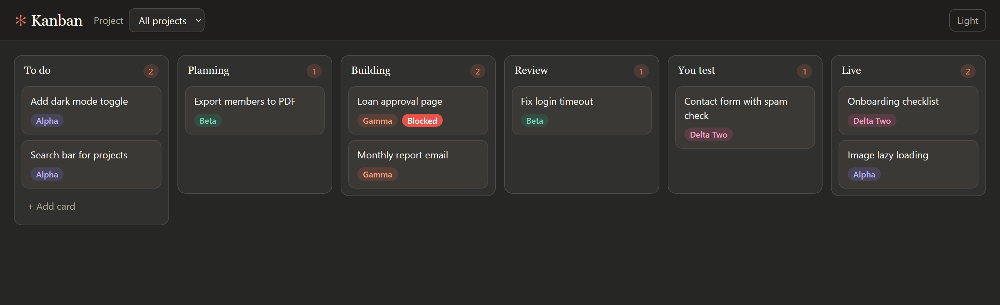

# Kanban

A local kanban board for working with Claude Code. One board for all your projects; Claude moves the cards as it works, and you can drag them too. Dragging a card into a work column opens a new Claude desktop session in that project's folder with the right message typed in.



```
To do → Planning → Building → Review → You test → Live
```

Plain PHP + MySQL + vanilla JS. No framework, no dependencies. Built for XAMPP on Windows.

## Setup

1. Copy this folder to `C:\xampp\htdocs\kanban` and start Apache and MySQL in XAMPP.
2. Create the database:
   ```
   C:\xampp\mysql\bin\mysql.exe -uroot -e "CREATE DATABASE kanban CHARACTER SET utf8mb4"
   C:\xampp\mysql\bin\mysql.exe -uroot kanban < schema.sql
   ```
3. Add your projects: copy `seed.example.sql` to `seed.local.sql`, put in your project names and folders, then:
   ```
   C:\xampp\mysql\bin\mysql.exe -uroot kanban < seed.local.sql
   ```
4. Open http://localhost/kanban.

Database settings other than XAMPP's default (`root`, no password) go in `config.local.php` (git-ignored); see `config.php`.

## Command line (used by Claude)

```
php board.php add "<title>" <project> [section]  # prints #id
php board.php move <id> <column> [pos]    # todo, planning, building, review, test, live
php board.php block <id> "<question>"
php board.php unblock <id>
php board.php find "<text>"
php board.php status <id> "<text>"        # what Claude is doing now; "" clears
php board.php note <id> "<text>"
php board.php notes <id>                  # oldest first
php board.php plan <id> <path>            # a .md file inside the project folder
php board.php section <id> "<name>"       # one of the card's project sections; none clears
php board.php sections <project>          # the project's sections, in report order
php board.php projects                    # every project: name | folder | sections
php board.php report <project> <from> <to>  # JSON of Done and underway cards per section, dates YYYY-MM-DD
php board.php sync                        # cards named in new verified DEPLOYMENTS.md entries go Live; prints the count
```

Upgrading from v1: back up, then `C:\xampp\mysql\bin\mysql.exe -uroot kanban < migrations/002_v2.sql`, then the same with `migrations/003_session_active.sql`.

To have Claude keep the board current, add a rule to your `~/.claude/CLAUDE.md` telling it to run these commands as work moves on.

## Working dot (hooks)

A card shows a pulsing dot while a Claude Code session works on it. Claude Code hooks run `hooks/claude_hook.php`, which links a session to card N when the prompt contains `card #N` (the board's links do) or when Claude runs `board.php <cmd> N`, and turns the dot and status off when the session stops (or after 30 min unseen). Add one entry per event to `~/.claude/settings.json`, next to any hooks you already have:

```json
"hooks": {
  "UserPromptSubmit": [{ "hooks": [{ "type": "command", "command": "C:/xampp/php/php.exe C:/xampp/htdocs/kanban/hooks/claude_hook.php", "timeout": 5 }] }],
  "PreToolUse":  [{ "matcher": "*", "hooks": [{ "type": "command", "command": "C:/xampp/php/php.exe C:/xampp/htdocs/kanban/hooks/claude_hook.php", "timeout": 5 }] }],
  "PostToolUse": [{ "matcher": "*", "hooks": [{ "type": "command", "command": "C:/xampp/php/php.exe C:/xampp/htdocs/kanban/hooks/claude_hook.php", "timeout": 5 }] }],
  "Stop":        [{ "hooks": [{ "type": "command", "command": "C:/xampp/php/php.exe C:/xampp/htdocs/kanban/hooks/claude_hook.php", "timeout": 5 }] }],
  "StopFailure": [{ "hooks": [{ "type": "command", "command": "C:/xampp/php/php.exe C:/xampp/htdocs/kanban/hooks/claude_hook.php", "timeout": 5 }] }]
}
```

The hook prints nothing and always exits 0, so a stopped MySQL never gets in Claude's way.

Blocking a card (from the page or `board.php block`) also shows a Windows notification, "Card #N needs you", through `notify/toast.ps1`. Set the environment variable `KANBAN_NO_NOTIFY` to turn it off.

## How the Claude link works

Dropping a card into Planning, Building, Review or Live opens
`claude://code/new?prompt=<message>&folder=<project folder>`. The message is typed in, not sent: you press Enter. Claude desktop asks you to confirm the folder each time. Note: `prompt=` works; `q=` did not fill the message in testing.

## Backups

`php board.php backup` saves the database to `%USERPROFILE%\KanbanBackups\kanban-YYYY-MM-DD.sql`, once a day, keeping the newest 7. It runs by itself at login (`autostart/open-kanban.vbs`), every day at 5 PM through a Windows scheduled task, and when a Claude turn ends with no backup for today yet (the Stop hook). The 5 PM task is skipped if the PC is off or asleep then; the other two catch up. Create the task with:

```
schtasks /Create /SC DAILY /ST 17:00 /TN "Kanban backup" /TR "wscript.exe \"C:\xampp\htdocs\kanban\autostart\backup.vbs\""
``` When MySQL is off it skips quietly; when a dump fails you get a toast.

Each day's backup is also copied to `%OneDrive%\KanbanBackups` (newest 7 kept there too), so a dead disk doesn't take the backups with it. To use another folder, add `define('BACKUP_COPY_DIR', 'D:\\Backups\\Kanban');` to `config.local.php` before its `return`. With no OneDrive and no `BACKUP_COPY_DIR`, nothing is copied. A failed copy shows a toast. The board's top bar shows a warning when there is no backup, the newest is 2 or more days old, or today's backup was not copied.

Restore a backup (this replaces the board's current data):

```
C:\xampp\mysql\bin\mysql.exe -uroot kanban < "%USERPROFILE%\KanbanBackups\kanban-YYYY-MM-DD.sql"
```

## Safety

The board only answers local requests (`Require local`, `localhost` host check, same-origin writes). The CLI, config, schema, tests and `.git` are not served over HTTP.

## Tests

```
php tests/lib_test.php
```

Creates and drops a `kanban_test` database.

Not affiliated with Anthropic.
